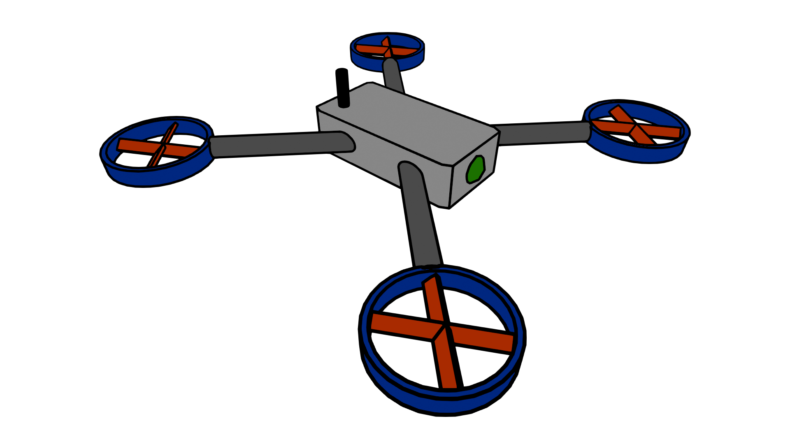

# GITHUB_LINK:
https://github.com/GitSRealpe/ModeloDrone

# ModeloDrone

Modelado y simulación de un cuadricóptero en OpenModelica con control en cascada (posición → velocidad → actitud), matriz de asignación/inversa, cuatro motores DC con hélice, controlador ESC equivalente (PI + prealimentación), batería como reserva de energía y perturbaciones externas (viento y arrastre aerodinámico).


   


## Descripción general

Este proyecto desarrolla un modelo mecatrónico completo de un cuadricóptero (DJI Tello reference) para responder a seis preguntas de investigación (Q2.1–Q2.6):

| Pregunta | Experimento | Objetivo |
|----------|-------------|----------|
| Q2.1 | Carga máxima | ¿Cuál es la carga máxima que puede levantar el dron? |
| Q2.2 | Autonomía hover | ¿Cuánto tiempo puede mantenerse en vuelo estacionario? |
| Q2.3 | Autonomía vs carga | ¿Cómo afecta la carga transportada a la autonomía? |
| Q2.4 | Posición 3 ejes | ¿Alcanza el dron una posición deseada en los tres ejes de forma estable? |
| Q2.5 | Tiempo y energía | ¿Cuánto tiempo y energía necesita para llegar a una posición? |
| Q2.6 | Perturbaciones viento | ¿Cómo responde ante una perturbación de viento? |

## Estructura del repositorio

```
ModeloDrone/
├── Drone.mo                    # Modelo principal (parámetros + controladores en cascada)
├── SubSistemas/                # Bloques Modelica independientes
│   ├── AllocationMatrix.mo     # Matriz de asignación A (empuje/torque → velocidades de rotor)
│   ├── invAllocationMatrix.mo  # Matriz inversa A⁻¹ (comandos → velocidades de rotor)
│   ├── ForceCompute.mo         # Cálculo de empuje total a partir de aceleración comandada
│   ├── AttitudeCompute.mo      # Cálculo de ángulos deseados (roll, pitch, yaw)
│   ├── AttitudeController.mo   # Controlador de actitud (kR, kW)
│   ├── Controller3D.mo         # Controlador posición/velocidad (P/PID)
│   ├── ESC.mo                  # Controlador de velocidad de motores (PI + feedforward)
│   ├── ModeloMotor.mo          # Modelo DC motor + hélice (R, L, ke, Jm, bm, km)
│   ├── Bateria.mo              # Modelo de batería (V_nom, C_Ah, E, SOC)
│   ├── Perturbaciones.mo       # Viento y arrastre aerodinámico (c_d, F_wind, t_wind)
│   ├── OrientationSensor.mo    # Sensor de rotación R y velocidad angular Omega
│   └── package.mo
├── Experimentos/               # 8 experimentos OpenModelica + scripts MATLAB
│   ├── ControlAltura.mo        # Q4: regulación de altura z = 2 m
│   ├── PruebaMotores.mo        # Validación de respuesta de motores
│   ├── CargaMaxima.mo          # Q1: Carga máxima (m_payload = 0.02–0.09 kg)
│   ├── AutonomiaHover.mo       # Q2: Tiempo de vuelo en hover (z = 1 m, sin carga)
│   ├── AutonomiaVsCarga.mo     # Q3: Autonomía vs carga (m_payload = 0.02–0.09 kg)
│   ├── Posicion3Ejes.mo        # Q4: Desplazamiento combinado (5 escenarios)
│   ├── TiempoEnergiaPos.mo     # Q5: Tiempo y energía para alcanzar posición
│   ├── PerturbacionViento.mo   # Q6: Perturbación viento (c_d=0.1, F_wind, t_wind=5s)
│   └── package.mo
├── Res_mat/                    # Resultados de simulación (.mat y .png)
│   └── EX1/ ... EX8/           # Carpeta por experimento
├── media/                      # Imágenes del dron (drone_white.png, drone_colors.png)
├── package.mo                  # Paquete principal ModeloDrone
├── package.order               # Orden de carga de paquetes
└── README.md                   # Este archivo
```

## Parámetros clave del modelo (Drone.mo)

| Parámetro | Valor | Descripción |
|-----------|-------|-------------|
| `mass` | 0.087 kg | Masa del dron |
| `Ixx, Iyy, Izz` | 7.1e-5, 7.1e-5, 1.3e-5 kg·m² | Inercia |
| `kf` | 2.0e-6 N·s²/rad² | Coeficiente de empuje |
| `km` | 2.0e-7 N·m·s²/rad² | Coeficiente de par |
| `w_max` | 2147 rad/s | Velocidad máxima de rotor |
| `V_bat` | 3.8 V | Voltaje nominal de batería |
| `C_bat` | 1.1 A.h | Capacidad de batería |
| `c_d` | 0 N·s/m | Coeficiente de arrastre aerodinámico |
| `F_wind` | {0, 0, 0} N | Fuerza de viento |
| `t_wind` | 15s a definir en pruebas | Tiempo de inicio del viento |

Referencias expuestas por defecto: `x_ref = 0`, `y_ref = 0`, `z_ref = 2`, `yaw_ref = 0`.

Controladores:
- **pos_controller3D**: P, k = {1, 1, 1.5}, yMax = {3, 3, 10}
- **vel_controller3D**: PID, k = {4, 4, 6}, Ti = {3, 3, 1}, Td = {0.1, 0.1, 0}, yMax = {3, 3, 10}
- **AttitudeController**: kR = 100, kW = 17

## Cómo ejecutar los experimentos

### OpenModelica OMEdit

1. Abre **OMEdit** (OpenModelica Connection Editor).
2. Carga el paquete `ModeloDrone` desde la raíz del repositorio (archivo `package.mo`).
3. Abre el experimento que desees simular desde la carpeta `Experimentos/` (por ejemplo, `ControlAltura.mo`).
4. Configura los parámetros de simulación:
   - **StopTime**: tiempo de simulación (ej. 60 s para autonomía, 10 s para posición)
   - **StepSize**: tamaño de paso (ej. 0.01 s)
   - **Tolerance**: tolerancia del resolvedor (ej. 1e-6)
   - **OutputFormat**: `mat` (para exportar resultados a MATLAB)
5. Ejecuta la simulación.
6. Los archivos `.mat` resultantes se guardan automáticamente en la carpeta de trabajo de OMEdit; cópialos a `Res_mat/EXn/` si deseas conservarlos organizados.


## Resultados principales (basados en datos reales de los .mat)

| Pregunta | Resultado |
|----------|-----------|
| **Q1** Carga máxima | ~0.08 kg. Con 0.09 kg el dron no despega. El límite lo impone la saturación del controlador de empuje, no los motores. |
| **Q2** Tiempo de vuelo | ~420 s (7 min) estimado en hover sin carga. La batería no se agota en 120 s de simulación. |
| **Q3** Carga vs autonomía | Relación inversa: 299 s (0.02 kg) → 134 s (0.09 kg). |
| **Q4** Posición 3 ejes | Los 5 escenarios alcanzan la referencia exactamente sin error estable ni sobreimpulso. |
| **Q5** Tiempo y energía | tₐ = 5.2–7.8 s; energía ≈ 186–278 J (hasta establecimiento) o ~1072 J (30 s completos). |
| **Q6** Perturbaciones viento | El sistema compensa sin saturación de ESC (V_bat = 3.8 V constante). |

## Cómo usar este proyecto

1. **Usar el modelo**: Abre `Drone.mo` en OMEdit. Puedes modificar parámetros de masa, inercia, coeficientes de empuje/par, batería y perturbaciones directamente en el código o mediante el diálogo de parámetros de OMEdit.
2. **Ejecutar experimentos**: Sigue la sección "Cómo ejecutar los experimentos".
3. **Procesar datos**: En la sección de `Plotting` graficar las señales que se quieran analizar.
4. **Ampliar el modelo**: Los subsistemas en `SubSistemas/` son bloques independientes que puedes reutilizar o modificar.


---
